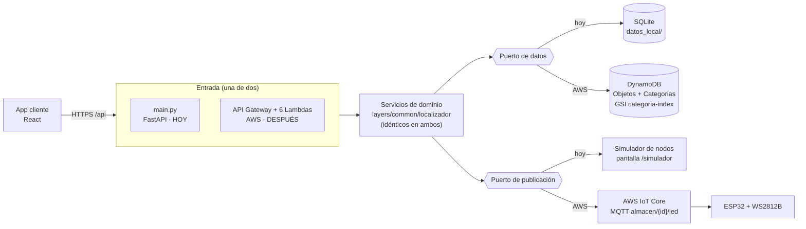

# Localizador inteligente de objetos: estado del proyecto

> Última actualización: 2026-10-05
> **Situación actual:** el proyecto funciona completo **en local, sin AWS**. Cuando la cuenta de AWS esté lista, se despliega el mismo código siguiendo la [sección 6](#6-configurar-aws-cuando-este-lista-la-cuenta).

---

## 1. Qué es

Un sistema para encontrar objetos en un almacén. El usuario busca un objeto en la app y el sistema **enciende un LED en el anaquel exacto** donde está.

| Capa | Qué hace | Estado |
|---|---|---|
| **App cliente** (web/móvil) | Buscar, registrar, editar y localizar objetos | ✅ Funciona en local |
| **Backend** | API que guarda los objetos y ordena encender LEDs | ✅ Funciona en local · ⏳ AWS pendiente |
| **Capa física** | Nodos ESP32 con tiras LED WS2812B en cada anaquel | 🧪 Simulada en pantalla · ⏳ firmware pendiente |

---

## 2. Cómo verlo funcionando (hoy, sin AWS)

### Encender el backend desde PyCharm (un solo comando)

1. **Intérprete:** Settings → Project → Python Interpreter → *Add Interpreter* → *Existing* → `.venv\Scripts\python.exe`. Con eso, la terminal de PyCharm activa el `.venv` sola.
2. **Comando**, en la terminal de PyCharm y desde la raíz del proyecto:

   ```bash
   python -m uvicorn main:app --reload
   ```

3. **Abre http://127.0.0.1:8000**. Ahí está la app web completa, servida por el propio backend.

> [!warning] Usa `127.0.0.1`, no `localhost`
> Si tienes encendido el contenedor `dynamodb-local` (el de las pruebas con SAM), también ocupa el puerto 8000. Docker lo expone además por IPv6, y `localhost` puede resolverse a IPv6 y abrir DynamoDB Local en vez de la app. `127.0.0.1` va siempre a la app.
>
> El modo local usa SQLite y **no necesita ese contenedor**. Si no vas a probar con SAM, apágalo:
>
> ```bash
> docker stop dynamodb-local
> ```

`--reload` reinicia el servidor cada vez que guardas un `.py`. La base de datos se crea sola en `datos_local/localizador.db` con 12 objetos y 4 categorías de demostración. Para empezar de cero, borra esa carpeta y reinicia el servidor.

| Dirección | Qué hay |
|---|---|
| http://127.0.0.1:8000 | La app web |
| http://127.0.0.1:8000/docs | Documentación interactiva de la API (Swagger), solo en local |
| http://127.0.0.1:8000/api/objetos | La API directamente, en JSON |

### Primera vez en una máquina nueva

```bash
python -m venv .venv
```

```bash
.venv\Scripts\pip install -r requirements-dev.txt
```

```bash
cd frontend
```

```bash
npm install
```

```bash
npm run build
```

### Si vas a modificar las pantallas

Lo que sirve el puerto 8000 es la versión **compilada** del frontend (`frontend/dist`). Mientras diseñas, usa el servidor de desarrollo, que recarga al instante. En otra terminal, con el backend encendido:

```bash
cd frontend
```

```bash
npm run dev
```

Y abre http://localhost:5173. Cuando termines, `npm run build` (dentro de `frontend/`) actualiza lo que sirve el 8000.

### Recorrido sugerido para entender el sistema

1. **Mapa (la pantalla de inicio):** escribe *taladro* en el buscador y elige el resultado. Se abre el anaquel donde está y **su LED se enciende en el plano**, con la cuenta regresiva.
2. **Anaquel:** toca cualquier otro objeto del alzado para encender el suyo. La tira de cada nivel muestra qué posición corresponde a qué objeto.
3. **La tira del nodo:** despliega *Ver la tira completa del nodo*, dentro del mismo mapa. Eso es exactamente lo que recibiría el ESP32 del almacén.
4. **La prueba que más ilustra:** abre el mapa en otra pestaña (o en tu teléfono, en la misma red) y localiza objetos desde la primera. El LED se enciende en menos de un segundo, igual que pasaría en el anaquel.
5. **Objetos:** la lista completa, con filtro por categoría y búsqueda sobre todo el catálogo. Abre *Taladro percutor* para ver su ficha, las entradas y salidas, y el botón **Localizar** con tiempo configurable.
6. **Registrar objeto:** la ubicación se arma tocando los pasillos y anaqueles que ya existen, y la posición del LED se elige en la tira: las ocupadas aparecen tomadas y no se pueden pulsar.
7. **Etiquetas:** desde la lista de objetos, *Etiquetas* abre la hoja imprimible con el QR de cada material.

---

## 3. Qué está hecho

### Backend
- [x] **Capa de dominio compartida** (`layers/common/localizador/`): validación, modelos, servicios y contratos (*puertos*). **La misma lógica corre en AWS y en local**; solo cambia la infraestructura que se conecta.
- [x] **13 funciones Lambda**, una por endpoint, con plantilla AWS SAM (`template.yaml`):
  - IAM mínimo por función.
  - CORS, incluidos los errores que genera API Gateway.
  - Throttling.
  - Tablas cifradas.
  - Retención de datos en `prod`.
- [x] **Servidor local** (`main.py` + `servidor_local/`): FastAPI con la **misma API**. SQLite hace de DynamoDB y un simulador hace de IoT Core.
- [x] **Seguridad**:
  - Validación estricta de toda entrada.
  - Protección contra inyección de *topic* MQTT (un `almacen_id` con `/`, `#` o `+` se rechaza).
  - Los errores nunca filtran detalles internos.
  - SQL solo con parámetros.
- [x] **Una posición de LED por almacén**: dar de alta o mover un objeto a una posición ya
  ocupada devuelve `409`. Dos objetos en el mismo LED se encenderían juntos y la ubicación
  física dejaría de ser unívoca. La regla vive en `ServicioObjetos`, así que vale igual en AWS
  y en local.
- [x] **Paginación por cursor** (keyset), igual en DynamoDB y en SQLite.
- [x] **Plano del almacén** (`GET /almacenes` y `GET /almacenes/{almacen_id}/plano`): agrupa los
  objetos en pasillos → anaqueles → niveles y rellena los niveles vacíos, para que el mapa se
  parezca al anaquel real. El agrupamiento vive en `layers/common/localizador/plano.py` y es una
  función pura, así que sale igual en AWS que en local.
- [x] **Entradas y salidas** (`POST /movimientos` y `GET /movimientos?object_id=`): cada movimiento
  ajusta la cantidad del objeto y queda en el historial **en una sola operación atómica**
  (transacción en SQLite; `TransactWriteItems` en DynamoDB). Una salida mayor que las existencias
  responde `409` y no mueve nada. El historial se ordena con marca de tiempo de microsegundos,
  porque con precisión de segundos dos movimientos del mismo segundo quedaban en orden aleatorio.
- [x] **Indicador de tiempo instrumentado** (`POST /busquedas`, `POST /busquedas/{id}/confirmar`,
  `GET /metricas/localizacion`): pulsar *Localizar* abre un cronómetro que se cierra al confirmar
  el hallazgo o al registrar la salida del material. Se comparan las búsquedas con el sistema
  contra mediciones manuales de referencia y se calcula la reducción, que es la meta del 40 %
  del acta. Sin las dos muestras el sistema **no inventa un porcentaje**: devuelve `null`.
- [x] **77 pruebas automáticas**:
  - Validación.
  - API completa de extremo a extremo.
  - Paginación.
  - Conflictos y errores.
  - Encendido del LED.
  - Plano del almacén (agrupamiento, niveles vacíos, 404 y 400).
  - Entradas y salidas (cantidad ajustada, 409 sin existencias, orden del historial y paginación).
  - Indicador de tiempo (apertura y cierre del cronómetro, doble confirmación, promedios y percentiles).

  ```bash
  .venv\Scripts\python -m pytest tests
  ```

- [x] **Verificado con SAM CLI**: `sam validate --lint`, `sam build --use-container` y `sam local invoke` (una Lambda respondiendo 400 bien formado en su contenedor real).

- [x] **Eliminar objetos** (`DELETE /objetos/{id}`): solo si ya no le quedan existencias
  (`409` con la cantidad que queda). Libera su posición de LED y **conserva el historial** de
  movimientos y búsquedas, que es la auditoría del inventario.
- [x] **Categorías desde la app** (`POST /categorias`, `PUT` y `DELETE /categorias/{id}`). El
  código de una categoría no se cambia porque lo usan sus objetos; no se elimina una categoría
  que todavía tiene objetos (`409`), y no se registra un objeto con una categoría que no existe (`400`).
- [x] **Búsqueda por nombre en el servidor** (`GET /objetos?q=texto`): sin distinguir mayúsculas
  ni acentos ("MULTIMETRO" encuentra "Multímetro digital"), también por código, combinable con
  `categoria` y paginada. En DynamoDB se guarda una copia normalizada del nombre
  (`nombre_busqueda`) y se recorre con filtro; alcanza para cientos o pocos miles de objetos.
- [x] **Usuarios con Cognito**: toda la API exige iniciar sesión. Sin registro abierto: las cuentas
  las crea un administrador y cada usuario cambia su contraseña temporal al entrar. Dos grupos:
  - `operadores`: buscar, localizar, registrar y editar objetos, mover material.
  - `administradores`: además, eliminar objetos y gestionar categorías. La API lo comprueba en
    cada Lambda (`403` si no), no solo la app.
- [x] **CORS listo para producción**: el parámetro solo acepta un origen exacto, y una regla de
  la plantilla **rechaza desplegar `prod` con `*`**. Hay un entorno `prod` en `samconfig.toml`.
- [x] **Política IoT por nodo** en la plantilla: cada ESP32 solo se conecta con su propio nombre
  y solo escucha el topic de su almacén.
- [x] **Identificación por foto con Amazon Rekognition**: la app sube la foto directo a S3 con una
  URL prefirmada (solo JPEG, máximo 5 MB); el evento de S3 dispara la Lambda, que pide a
  Rekognition etiquetas y texto, y guarda una **propuesta** (nombre, categoría, código leído y
  confianza). La IA **solo propone**: el formulario se prellena y la persona confirma. Las fotos
  se borran a los 30 días (regla del bucket) y cada usuario solo ve sus propias identificaciones.
- [x] **Firmware del ESP32** (`firmware/nodo_almacen/`): MQTT con TLS mutuo hacia IoT Core,
  varios LEDs encendidos a la vez con su propio temporizador, reconexión automática y validación
  de cada orden. **Compila** para `esp32dev` sin advertencias; falta probarlo en una placa real.

### Frontend (`frontend/`: React + Vite + Tailwind + shadcn/ui)

| Pantalla | Ruta | Qué hace |
|---|---|---|
| Mapa | `/` | **Pantalla de inicio.** El almacén visto desde arriba: filas de anaqueles separadas por sus pasillos, con buscador propio. Al elegir un objeto se abre el alzado de su anaquel como una **estantería real: niveles (filas) × columnas**, con los huecos libres y la tira LED de cada repisa, y **se enciende su LED en el plano**, con cuenta regresiva. Trae plegado el simulador del nodo. Llegando desde un objeto (`?objeto=`) su anaquel aparece abierto y resaltado |
| Objetos | `/objetos` | Lista con filtro por categoría y "cargar más". Al escribir en el buscador se trae **todo el catálogo**, no solo la página cargada. En escritorio es una tabla; en móvil, tarjetas |
| Detalle | `/objetos/:id` | Ubicación (almacén, pasillo, anaquel, nivel) y botón **Localizar** con tiempo configurable; muestra la tira LED con cuenta regresiva, y el panel de **entradas y salidas** con las existencias y su historial |
| Registrar | `/objetos/nuevo` | Alta con validación en vivo. La ubicación sugiere los almacenes, pasillos, anaqueles y niveles **que ya existen** (y admite nuevos), y la posición del LED se elige tocándola en la tira: las ocupadas no se pueden pulsar. Código opcional (si no se da, se genera) |
| Editar | `/objetos/:id/editar` | Cambiar ubicación, LED o color |
| Métricas | `/metricas` | Comparación entre el método manual y el sistema, con promedio, mediana y P90, el porcentaje de reducción frente a la meta del 40 %, y el alta de mediciones manuales |
| Etiquetas | `/etiquetas` | Hoja imprimible con una etiqueta por objeto: código QR que abre su ficha, nombre y ubicación. Se entra desde la lista de objetos |
| Categorías | `/categorias` | Tarjetas por categoría; cada una lleva a sus objetos. Un administrador crea, edita y elimina categorías aquí. Se entra desde la lista de objetos |
| Inicio de sesión | (antes de todo) | Solo en AWS: correo y contraseña de Cognito, con el cambio obligatorio de la contraseña temporal |
| Simulador | `/simulador` | La tira LED completa de cada almacén, actualizándose cada segundo (**solo en local**). También aparece plegado dentro del mapa |

- [x] Diseño con el estándar de `diseno-ui.md`:
  - Tokens de diseño y modo oscuro.
  - Estados de carga, vacío y error en todas las pantallas.
  - Objetivos táctiles de 44 px en móvil.
  - Navegación inferior en el teléfono.
  - Accesibilidad (etiquetas, foco visible, `aria-live` en el resultado de localizar).
- [x] Validación en el cliente con **las mismas reglas** que el backend.
- [x] **Navegación de cinco destinos** (Mapa, Objetos, Categorías, Registrar, Métricas). Categorías
  quedó fija en la barra para llegar a ella sin pasar por la lista de objetos.
- [x] **Columnas en los anaqueles**: cada objeto se ubica en nivel **y columna** (dato `columna`,
  opcional en la API; por defecto "A"). El mapa dibuja la cuadrícula completa con al menos tres
  columnas, y las bases viejas se migran solas repartiendo los objetos por el orden de su LED.
- [x] **Búsqueda por voz**: botón de micrófono dentro de los buscadores de Objetos y del Mapa. Usa el
  reconocimiento de voz del navegador (Web Speech API, es-MX) y quita muletillas ("¿dónde está el…?").
  En el mapa, si lo dicho coincide con un solo objeto, se enciende su LED directo. Funciona en
  Chrome, Edge y Safari, y solo en `https` o `localhost` (el navegador lo exige para el micrófono);
  en Firefox el botón no aparece.

### Herramientas y entorno
- [x] Instalados: AWS CLI 2.36, SAM CLI 1.166, Obsidian 1.13 y dependencias Python en `.venv`.
- [x] Skill `crear-fullstack` ampliado con **Starter React** verificado y estándar de diseño común a Angular y React.

---

## 4. Arquitectura



**Por qué así:** la lógica de negocio no sabe si corre en AWS o en tu PC. Por eso hoy puedes desarrollar y probar todo sin cuenta de AWS, y mañana desplegar **sin reescribir nada**: solo se cambian los adaptadores.

### Diferencias entre el modo local y AWS

| Aspecto | Local (hoy) | AWS (cuando se despliegue) |
|---|---|---|
| Cómo se enciende | `python -m uvicorn main:app --reload` | `sam deploy` |
| URL de la API | `http://127.0.0.1:8000/api` | `https://{id}.execute-api.{región}.amazonaws.com/{entorno}` |
| Datos | SQLite (`datos_local/localizador.db`) | DynamoDB |
| Encender LED | Se guarda la orden y la muestra el simulador | Mensaje MQTT real a IoT Core → ESP32 |
| Pantalla Simulador | Visible | Oculta (`VITE_DEMO_LOCAL=false`) |
| Autenticación | Ninguna: todas las acciones están disponibles | Cognito: hay que iniciar sesión; borrar y gestionar categorías solo para `administradores` |
| Identificación por foto | No disponible (no hay S3 ni Rekognition) | Panel "Identificar con foto" al registrar (`VITE_VISION=true`) |

### Contrato con el firmware del ESP32

Es la interfaz que no se puede romper sin actualizar también el firmware:

- **Topic:** `almacen/{almacen_id}/led` (QoS 1). Cada nodo se suscribe **solo** al de su almacén.
- **Payload:**

  ```json
  {
    "posicion_led": 42,
    "color_indicador": "#00FF00",
    "duracion_segundos": 30,
    "object_id": "obj-demo-001",
    "emitido_en": "2026-09-13T12:00:00+00:00"
  }
  ```

---

## 5. Qué falta

### ⏳ Configurar AWS
Ver la [sección 6](#6-configurar-aws-cuando-este-lista-la-cuenta). Es el siguiente paso cuando la cuenta esté lista.

### 🧪 Probar con hardware y servicios reales
- [ ] **Firmware en una placa real.** Compila, pero no se ha grabado en un ESP32 ni probado contra IoT Core. Guía en `firmware/nodo_almacen/README.md`.
- [ ] **Cognito y Rekognition reales.** El inicio de sesión y la identificación por foto se probaron en el navegador con respuestas simuladas, y la lógica con pruebas automáticas; falta probarlos con la cuenta de AWS.

### 🧩 Funcionalidad que aún no existe
- [ ] **Detección de discrepancias (YOLOv8n).** Es la segunda IA de la propuesta: necesita un modelo entrenado por el equipo con fotos de los materiales del catálogo. Sin ese modelo no se puede construir.
- [ ] **Normalización con Bedrock (opcional).** Hoy las etiquetas de Rekognition se traducen con un diccionario (`layers/common/localizador/vision.py`).
- [ ] **Recuperar contraseña desde la app.** Hoy un administrador la restablece desde la consola de Cognito.
- [ ] **Hospedaje del frontend en AWS** (S3 + CloudFront o Amplify Hosting). Hace falta para tener el dominio exacto que pide el CORS de `prod`.

### 🎨 Diseño y organización
- [ ] **Paleta SL Group.** Los colores actuales son provisionales (`frontend/src/styles/index.css`).
- [ ] **Vault de Obsidian.** Obsidian está instalado pero el vault con los estándares no está en esta máquina.
- [x] **Control de versiones.** Repositorio git en la rama `main` (2026-09-30). El `.gitignore` excluye `.venv`, `node_modules`, `dist`, `datos_local`, `env.json`, el `config.h` del firmware (lleva la clave privada del nodo) y la carpeta de la tarea de IA, que es otro proyecto.
- [x] **Repositorio remoto** (2026-10-05): https://github.com/LuisAndana/localizador-objetos (privado). Para compartirlo con el equipo: *Settings → Collaborators* en GitHub.
- [ ] **CI**: correr `pytest`, `tsc` y `sam validate --lint` en cada cambio.

---

## 6. Configurar AWS (cuando esté lista la cuenta)

El código ya está preparado; solo falta conectar la cuenta. Orden recomendado:

### 6.1 Credenciales
1. En la consola de AWS, crea un **usuario IAM para desplegar** (no uses la cuenta raíz) y genérale una *access key*.
2. En una terminal:

   ```bash
   aws configure
   ```

   Pide la *access key*, el *secret* y la región (por ejemplo `us-east-1`). Las claves se escriben solo ahí, **nunca en el código ni en el repositorio**.
3. Comprueba que funcionan:

   ```bash
   aws sts get-caller-identity
   ```

### 6.2 IoT Core (para los ESP32)
1. Obtén el endpoint de IoT de la cuenta:

   ```bash
   aws iot describe-endpoint --endpoint-type iot:Data-ATS --query endpointAddress --output text
   ```

2. Para cada nodo ESP32, registra un **Thing** cuyo nombre sea el `almacen_id` (por ejemplo `almacen-01`), con su propio certificado, y adjúntale la política del stack (salida `PoliticaIoTNodos`). La política ya viene en la plantilla: el nodo solo puede suscribirse a `almacen/{su-almacen}/led`, así que un nodo comprometido no puede leer ni encender LEDs de otro almacén. Los comandos exactos están en `firmware/nodo_almacen/README.md`.

### 6.3 Desplegar el backend
Con Docker Desktop abierto:

```bash
sam build --use-container
```

```bash
sam deploy --guided
```

| Parámetro | Valor |
|---|---|
| Stack Name | `localizador-objetos-dev` |
| `Entorno` | `dev` (luego `prod`) |
| `EndpointIoT` | el host del paso 6.2 (si lo dejas vacío, despliega en modo simulación) |
| `OrigenCorsPermitido` | el dominio donde vivirá la app (en `dev` puede ser `*`) |

Al terminar, apunta las salidas **`UrlApi`**, **`IdClienteApp`**, **`RegionCognito`** e **`IdPoolUsuarios`**.

### 6.4 Crear los usuarios
El user pool no tiene registro abierto: las cuentas se crean así (cambia el correo y usa el `IdPoolUsuarios` del despliegue):

```bash
aws cognito-idp admin-create-user --user-pool-id ID_DEL_POOL --username persona@empresa.com --user-attributes Name=email,Value=persona@empresa.com Name=email_verified,Value=true
```

Cognito envía por correo una contraseña temporal; en el primer ingreso la app pide cambiarla. Después, agrega a la persona a su grupo:

```bash
aws cognito-idp admin-add-user-to-group --user-pool-id ID_DEL_POOL --username persona@empresa.com --group-name administradores
```

(o `operadores`). Crea al menos un administrador: es quien da de alta las categorías.

### 6.5 Apuntar la app a AWS y cargar los datos
En `frontend/.env.production`:

```bash
VITE_API_URL=https://{id}.execute-api.{región}.amazonaws.com/dev
VITE_DEMO_LOCAL=false
VITE_COGNITO_REGION=us-east-1
VITE_COGNITO_CLIENT_ID=el-IdClienteApp-del-despliegue
VITE_VISION=true
```

Después ejecuta `npm run build` y publica `frontend/dist` (por ejemplo en S3 + CloudFront o en Amplify Hosting). Actualiza `OrigenCorsPermitido` con ese dominio y vuelve a desplegar.

Las tablas nacen vacías: entra como administrador, crea las categorías en **Categorías** y registra los objetos desde la app.

### 6.6 Pasar a `prod`
Edita en `samconfig.toml`, sección `[prod.deploy.parameters]`, el `OrigenCorsPermitido` con el dominio exacto de la app y el `EndpointIoT`. Luego:

```bash
sam deploy --config-env prod
```

- La plantilla **rechaza** el despliegue si el CORS de `prod` se queda en `*`.
- `Entorno=prod` activa la retención de las tablas y del user pool, y el Point-in-Time Recovery.
- Es otro stack (`localizador-objetos-prod`) con su propio user pool: hay que crear sus usuarios (6.4).

---

## 7. Estructura del proyecto

```
prueba localizador de objetos/
├── ESTADO_DEL_PROYECTO.md       ← este documento
├── README.md                    # Detalle técnico del backend y de AWS SAM
├── main.py                      # Backend LOCAL (FastAPI): python -m uvicorn main:app --reload
├── servidor_local/              # SQLite + simulador de nodos (sustituyen a DynamoDB e IoT Core)
├── layers/common/localizador/   # Dominio compartido: servicios, validación, modelos, puertos
│                                #   + adaptadores AWS (repositorios.py = DynamoDB, iot.py = IoT Core)
├── src/                         # Las 20 Lambdas (AWS): una por endpoint, más identificar_objeto (evento de S3)
├── template.yaml                # Infraestructura AWS (SAM)
├── samconfig.toml · env.json.example
├── events/                      # Eventos de prueba para sam local invoke
├── scripts/bootstrap_local.py   # Tablas y datos en DynamoDB Local
├── tests/                       # 173 pruebas (pytest)
├── frontend/                    # App React
│   └── src/features/            #   objetos/ · categorias/ · plano/ · auth/ · identificacion/ · simulador/
├── firmware/nodo_almacen/       # Firmware del ESP32 (PlatformIO): MQTT + tira WS2812B
├── requirements-local.txt       # FastAPI + uvicorn (modo local)
└── requirements-dev.txt         # + boto3, pytest, httpx
```

---

## 8. Decisiones tomadas

| Decisión | Por qué |
|---|---|
| Serverless (Lambda) en AWS | El tráfico es por ráfagas (alguien busca un objeto). Se paga solo por uso |
| DynamoDB | Acceso por `object_id` y por `categoria` (GSI); sin joins ni reportes |
| IoT Core + MQTT | Canal gestionado y seguro (TLS mutuo) hacia los ESP32 |
| Servidor local con la misma lógica | Desarrollar y demostrar sin AWS, sin duplicar reglas de negocio |
| React para el frontend | Lo más rico en componentes pulidos; Starter verificado |
| Respuesta `202` al localizar | El backend publica la orden, pero no puede confirmar que el LED encendió |
| Cognito sin SDK en la app | La API de Cognito es un POST JSON; evita una dependencia pesada para tres llamadas |
| Grupos `administradores` y `operadores` | Borrar y gestionar categorías no se deshace: lo hace solo quien administra, y la API lo comprueba |
| Búsqueda con `nombre_busqueda` en DynamoDB | Sin servicio extra para el volumen del semestre; con decenas de miles de objetos tocaría OpenSearch |
| Foto directa a S3 con URL prefirmada | La imagen no pasa por API Gateway (límite de 10 MB y costo por GB); S3 limita tipo y tamaño |
| No borrar objetos con existencias | Eliminar material que sigue en el anaquel haría desaparecer inventario real |

## 9. Problemas encontrados y ya resueltos

- La Lambda Layer quedaba en `python/python/`: en AWS habrían fallado todos los imports. **Corregido.**
- `env.json.example` rompía `sam local` por una clave de comentarios. **Corregido.**
- En el Starter React:
  - `shadcn init` borraba los tokens de diseño.
  - Usaba Base UI en vez de Radix.
  - Los botones medían 32 px en vez de 44.
  - Había incompatibilidades con TypeScript 6 y Vite 8.

  **Todo corregido y documentado en el skill.**
- Las Lambdas de crear y actualizar objeto no tenían permiso de `Scan` (ni `GetItem` la de
  actualizar), que necesita la comprobación de que la posición del LED esté libre: en AWS habrían
  fallado con acceso denegado. **Corregido** en la plantilla.
- Las tarjetas de **Categorías** llevaban al mapa (`/?categoria=`), que no filtra por categoría.
  **Corregido**: ahora abren la lista de objetos filtrada.
