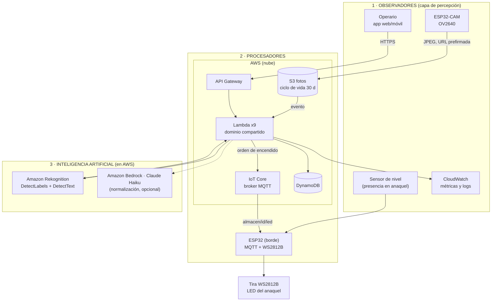
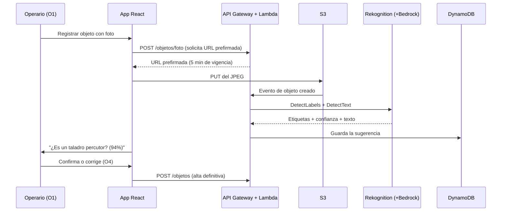

# Propuesta de proyecto — Localizador inteligente de objetos

> **Materia:** Cómputo en la Nube
> **Fecha de la propuesta:** 18 de septiembre de 2026
> **Documento hermano:** [ESTADO_DEL_PROYECTO.md](ESTADO_DEL_PROYECTO.md) (avance técnico ya construido)

---

## 1. Resumen ejecutivo

Un almacén pierde tiempo buscando objetos que sí están, pero nadie recuerda en qué anaquel.
Este proyecto resuelve eso con tres piezas: el operario **busca el objeto en una app**, la nube
**decide dónde está** y un **LED se enciende en el anaquel exacto**, con una cuenta regresiva,
para que la persona camine directo al lugar.

Sobre esa base se añade **identificación visual**: al dar de alta un objeto, una foto se
identifica sola con inteligencia artificial y la app rellena nombre y categoría; la persona solo
confirma. Y cuando el peso de un nivel baja sin que nadie registre la salida, un **segundo modelo,
entrenado con los materiales del propio almacén**, dice cuál falta y abre una alerta.

La decisión de arquitectura central de esta propuesta: **toda la inteligencia vive en AWS, no en
una computadora del almacén**. El borde se queda con un microcontrolador ESP32 de bajo costo que
solo enciende luces y captura imágenes. Esto quita ~$3,000 MXN de hardware del presupuesto, deja
el costo de nube en **$0 dentro de la capa gratuita** para el volumen del semestre, y pone la
parte de IA dentro de AWS, que es justo lo que evalúa la materia.

---

## 2. Problema y justificación

| Situación | Consecuencia |
|---|---|
| El inventario existe en papel o en una hoja de cálculo | Nadie sabe la ubicación exacta, solo "está en el almacén" |
| La ubicación se guarda como texto ("pasillo 3") | Hay que recorrer el pasillo completo leyendo etiquetas |
| Dar de alta un objeto es teclear todo a mano | Se registra mal o no se registra |

La búsqueda física es el cuello de botella, no la base de datos. Por eso el sistema no termina en
una pantalla: **termina en una luz encendida en el estante**.

---

## 3. Objetivos

**Objetivo general.** Construir y desplegar en AWS un sistema que localice físicamente objetos en
un almacén mediante señalización luminosa, y que use inteligencia artificial para identificar
objetos a partir de una fotografía.

**Objetivos específicos.**

1. Desplegar una API serverless (API Gateway + Lambda + DynamoDB) con el CRUD de objetos,
   categorías y plano del almacén.
2. Emitir órdenes de encendido a los nodos físicos por AWS IoT Core (MQTT sobre TLS mutuo).
3. Construir el nodo de anaquel: ESP32 + tira LED WS2812B, con apagado automático.
4. Integrar **Amazon Rekognition** para identificar objetos por foto y prellenar el alta, y un
   modelo **YOLOv8n propio** que detecte cuál de los materiales del catálogo falta cuando hay una
   discrepancia entre el peso y el inventario.
5. Demostrar el sistema completo de extremo a extremo con un anaquel real de prueba.
6. Documentar costos, seguridad y límites de la solución.

---

## 4. Alcance

**Dentro del alcance**

- App web responsiva (React) para buscar, registrar, editar y localizar.
- Backend serverless en AWS, con el mismo código corriendo en local para desarrollo.
- Nodo físico ESP32 con tira LED en un anaquel de prueba (2 a 4 niveles).
- Identificación visual por IA con confirmación humana.
- Plano 2D del almacén con la posición resaltada.

**Fuera del alcance (declarado a propósito)**

- Reconocimiento continuo por video (solo foto a petición).
- Control de stock, entradas/salidas y costos de inventario.
- Instalación en el almacén completo: se demuestra en un anaquel.
- Cómputo de visión en el borde (ver §9, alternativa evaluada y descartada).

---

## 5. Arquitectura general



**Principio de diseño:** la lógica de negocio (`layers/common/localizador/`) no sabe si corre en
AWS o en una laptop. Solo cambian los adaptadores. Por eso el sistema ya funciona hoy en local
sin cuenta de AWS, y se despliega sin reescribir reglas.

---

## 6. Observadores

Son las fuentes que **perciben el estado del mundo** y alimentan al sistema. Se dividen en
observadores físicos (hardware en el almacén) y lógicos (software que observa al propio sistema).

| # | Observador | Tipo | Qué observa | Cómo entrega el dato | Dónde vive |
|---|---|---|---|---|---|
| O1 | **Operario en la app** | Humano | La intención: qué objeto se busca, qué objeto se da de alta | `HTTPS → API Gateway` (JSON) | Navegador / teléfono |
| O2 | **Cámara del teléfono del operador** *(ESP32-CAM como ampliación)* | Óptico | La imagen del objeto que se da de alta y la del anaquel cuando hay una discrepancia | JPEG a S3 con URL prefirmada (no expone credenciales) | Teléfono; la ESP32-CAM iría fija en el anaquel |
| O3 | **Celda de carga 5 kg + HX711** | Peso | Cuánto peso hay en el nivel instrumentado: detecta retiros y colocaciones | Variación al ESP32 → MQTT `almacen/{id}/nodo/{id}/peso` | Bajo la charola del nivel |
| O4 | **Confirmación humana** | Humano | Si la identificación de la IA fue correcta | `PUT /objetos/{id}` | App |
| O5 | **CloudWatch Logs y métricas** | Software | Latencia, errores, invocaciones, mensajes MQTT | Automático desde Lambda e IoT Core | AWS |
| O6 | **Códigos QR impresos** | Óptico | La identidad del material que entra o sale | La app lee el QR y llama a `POST /movimientos` | Etiqueta pegada a cada material |
| O7 | **Botón de confirmación** | Humano | Que el operador ya retiró el material del anaquel | Pulso digital al ESP32 → MQTT `.../confirmacion` | Frente del anaquel |

> [!note] Por qué la cámara apunta al anaquel y no al pasillo
> La cámara encuadra el estante, no las personas. Es la mitigación de privacidad más barata y la
> más fácil de defender: el sistema no puede grabar a quien pasa porque no lo tiene en cuadro.

**Regla que gobierna a los observadores:** ninguno actúa por sí mismo. Un observador solo
**reporta**; toda decisión de encender un LED o escribir en la base de datos la toma un procesador
en la nube, y toda escritura derivada de IA pasa por O4.

---

## 7. Procesadores

Son los que **transforman lo observado en decisiones y acciones**. Hay tres niveles.

### 7.1 Procesador de borde

| Elemento | Detalle |
|---|---|
| **Hardware** | ESP32 DevKit V1 — Xtensa LX6 doble núcleo a 240 MHz, 520 KB SRAM, Wi‑Fi 802.11 b/g/n |
| **Qué procesa** | Se suscribe a `almacen/{almacen_id}/led` (QoS 1), interpreta el JSON, calcula qué LED de la tira corresponde, lo enciende con el color indicado y **lo apaga solo** al cumplirse `duracion_segundos` |
| **Qué NO procesa** | Nada de visión, nada de modelos, nada de base de datos |
| **Autonomía sin internet** | Mantiene el último estado y apaga por temporizador local; reintenta la conexión MQTT con retroceso exponencial |
| **Por qué un microcontrolador basta** | El trabajo real es temporización y control de una tira direccionable: microsegundos de cómputo, no teraflops |

### 7.2 Procesadores en la nube (AWS)

| Servicio | Función en el sistema | Notas |
|---|---|---|
| **API Gateway (REST)** | Puerta única de entrada, CORS, throttling | Los errores que genera la propia puerta también llevan CORS |
| **AWS Lambda** | Una función por endpoint, más `identificar_objeto` (Rekognition) y `detectar_discrepancia` (YOLOv8n) | IAM mínimo por función; todas comparten la capa de dominio |
| **DynamoDB** | Tablas `Objetos` y `Categorias`, GSI `categoria-index` | Cifrado en reposo; PITR y retención en `prod` |
| **AWS IoT Core** | Broker MQTT con TLS mutuo hacia los ESP32 | Un certificado y una política por nodo |
| **Amazon S3** | Fotos de entrada y archivo | Regla de ciclo de vida: **borrado a los 30 días** |
| **CloudWatch** | Logs, métricas y alarmas | Observabilidad (ver O5) |
| **Amazon Cognito** *(pendiente, obligatorio antes de datos reales)* | Autenticación de la app | Hoy la API no pide login |

### 7.3 Procesador de presentación

El navegador del operario ejecuta la app React: valida con **las mismas reglas** que el backend,
pinta el plano 2D, muestra la tira LED simulada y la cuenta regresiva. No toma decisiones de
negocio; solo evita viajes inútiles al servidor.

---

## 8. Inteligencia artificial: qué modelo, qué manipula y hasta dónde puede

### 8.1 IA principal — Amazon Rekognition

| Aspecto | Definición |
|---|---|
| **Servicio** | Amazon Rekognition (modelo administrado por AWS, sin entrenamiento propio en la fase 1) |
| **Dónde se ejecuta** | Dentro de AWS, invocado por la Lambda `identificar_objeto` |
| **Qué recibe** | Un JPEG del objeto, leído de S3 (nunca se le envía la imagen desde el navegador) |
| **Operaciones que usa** | `DetectLabels` → qué es el objeto y con qué confianza · `DetectText` → OCR de la etiqueta, número de parte o código impreso |
| **Qué devuelve** | Lista de etiquetas con porcentaje de confianza y cadenas de texto detectadas |
| **Qué manipula del sistema** | **Solo propone.** Escribe una *sugerencia* en DynamoDB (`nombre_sugerido`, `categoria_sugerida`, `codigo_detectado`, `confianza`). Nunca modifica un objeto existente ni enciende un LED |

### 8.2 IA de apoyo — Amazon Bedrock (Claude Haiku), opcional

Rekognition devuelve etiquetas genéricas y en inglés (`Tool`, `Power Drill`, `Machine`). Un modelo
de lenguaje en Bedrock convierte esa salida cruda en algo que sirve en el catálogo:

- Traduce y normaliza al vocabulario del almacén ("Power Drill" → *Taladro percutor*).
- Elige la **categoría existente** más cercana en vez de inventar una nueva.
- Limpia el OCR (`0` contra `O`, guiones sobrantes) para proponer el código del objeto.

Se marca como opcional porque Bedrock no está en la capa gratuita; el costo por llamada es de
centavos y el sistema funciona sin él, solo con etiquetas menos pulidas.

### 8.3 Flujo de identificación, paso a paso



### 8.4 Reglas de uso de la IA (esto es lo que se defiende)

| Confianza de Rekognition | Comportamiento del sistema |
|---|---|
| ≥ 85 % | Prellena el formulario; la persona solo pulsa *Guardar* |
| 60 – 85 % | Muestra las tres mejores opciones para elegir |
| < 60 % | No sugiere nada; alta manual |

- **Humano en el circuito, siempre.** Ningún registro entra al catálogo sin que una persona lo
  confirme. La IA ahorra tecleo; no tiene autoridad sobre los datos.
- **La IA no toca el hardware.** Las órdenes de encendido las emite el servicio de dominio a
  partir de la ubicación guardada, nunca un modelo.
- **Trazabilidad.** Cada sugerencia guarda qué modelo la produjo y con qué confianza, para poder
  auditar un registro equivocado.

---

### 8.5 Segunda IA — modelo propio YOLOv8n para discrepancias

Rekognition responde *qué es esto* con etiquetas genéricas y en inglés (`Tool`, `Machine`). Eso
alcanza para prellenar un alta, pero **no distingue el taladro del nivel 2 del que está en el
nivel 3**, que es justo lo que hace falta cuando el peso baja sin que nadie registre una salida.
Para esa tarea se entrena un modelo propio con los materiales del almacén.

| Tarea | Modelo | Por qué ese |
|---|---|---|
| Dar de alta un material nuevo | **Rekognition** | Reconoce objetos que nunca vio; no hay nada que entrenar |
| Saber cuál de los 10 materiales falta | **YOLOv8n propio** | Solo conoce el catálogo, pero lo distingue con precisión |

- **Datos:** de 60 a 100 fotos por material, con distinta luz y posición, etiquetadas en Roboflow o
  CVAT.
- **Entrenamiento:** transferencia de aprendizaje en Google Colab o SageMaker Studio Lab, gratuitos.
- **Despliegue:** el modelo se exporta a ONNX (~12 MB) y viaja dentro de la imagen de contenedor de
  la Lambda `detectar_discrepancia`. No se instala nada en el almacén.
- **Cuándo se dispara:** solo cuando la celda de carga reporta una baja de peso sin movimiento
  registrado en los 60 segundos previos. No analiza imágenes de forma continua.
- **Límite honesto:** reconoce únicamente los materiales con los que se entrenó. Por eso las altas
  de objetos nuevos siguen siendo trabajo de Rekognition.

---

## 9. Decisión de arquitectura: por qué la IA vive en la nube y no en el almacén

Se evaluaron dos caminos para la visión por computadora.

| | **A · Visión en el borde** (Raspberry Pi 5 de 8 GB) | **B · Visión en la nube** *(propuesta)* |
|---|---|---|
| Hardware extra | Pi 5, fuente, microSD, disipador: ~$3,000 MXN | **$0** |
| Funciona sin internet | Sí | No para identificar (el LED y el catálogo sí) |
| Las fotos salen del almacén | No | Sí, con borrado a 30 días |
| Mantenimiento | Otro sistema operativo que parchar en sitio | Administrado por AWS |
| Relación con la materia | Cómputo fuera de la nube | **Cómputo en la nube** |
| Velocidad del modelo | Limitada por la placa | Modelo administrado, escala solo |

**Se elige B.** El ahorro es de ~$3,000 MXN, elimina un punto de falla físico y coloca la parte de
IA dentro de AWS, que es el objeto de evaluación de la materia.

**Lo que se pierde, dicho antes de que lo pregunten:** sin internet no hay identificación visual.
Los sensores, el catálogo cacheado y el apagado por temporizador del LED siguen operando, pero la
cámara no puede identificar nada hasta que vuelva el enlace.

**Si se exige procesamiento en el borde**, el sustituto mínimo es una **Raspberry Pi Zero 2 W**
(~$700 MXN con fuente y memoria) haciendo de puente y buffer MQTT, dejando la identificación en la
nube. Para la demostración del semestre, una laptop del equipo cuesta $0 y corre el modelo más
rápido que cualquier placa.

---

## 10. Flujos principales

**F1 · Localizar un objeto (el flujo que se demuestra).**
Buscar en la app → `POST /objetos/{id}/localizar` con la duración (15/30/60 s) → la Lambda
resuelve la posición del LED y publica en `almacen/{id}/led` → IoT Core entrega al ESP32 → el LED
parpadea en el anaquel. La API responde **202 Accepted**: publicó la orden, pero no puede
garantizar que la luz encendió. Tiempo objetivo de extremo a extremo: **menos de 1 segundo**.

**F2 · Registrar un objeto con IA.** El de la §8.3. Tiempo objetivo: **2 a 4 segundos** desde que
se sube la foto hasta que aparece la sugerencia.

**F3 · Ver el plano.** `GET /almacenes/{id}/plano` agrupa los objetos en pasillos → anaqueles →
niveles y rellena los vacíos, para que el dibujo se parezca al anaquel real.

---

## 11. Materiales y costos

### 11.1 Hardware — precios de referencia en MXN (verificar al comprar)

| Componente | Cantidad | Unitario | Subtotal |
|---|---:|---:|---:|
| ESP32 DevKit V1 (nodo de anaquel) | 1 | $160 | $160 |
| Celda de carga 5 kg + módulo HX711 | 1 | $110 | $110 |
| Tira LED WS2812B, 30 LED | 1 | $120 | $120 |
| Etiquetas QR impresas | 1 juego | $20 | $20 |
| Protoboard, cables y botón de confirmación | 1 juego | $150 | $150 |
| Cargador de celular 5 V / 2 A (reutilizado, brillo al 20 %) | 1 | $0 | $0 |
| Teléfono del operador: cámara y lector de QR (reutilizado) | 1 | $0 | $0 |
| Repisa o librero existente (reutilizado) | 1 | $0 | $0 |
| **Total del anaquel de demostración** | | | **≈ $560** |

Ninguna ampliación es necesaria para cumplir los criterios del acta, y ninguna obliga a reescribir
software: son los mismos eventos generados por otro dispositivo.

| Ampliación opcional | Costo | Qué agrega |
|---|---:|---|
| ESP32-CAM AI-Thinker (OV2640) + FTDI | $230 | La foto del anaquel se toma sola al cambiar el peso |
| 2 celdas de carga + HX711 | $220 | Los tres niveles detectan el retiro automáticamente |
| Lector RFID RC522 y etiquetas | $90 | Identificación sin sacar el teléfono |
| Tira de 60 LED y fuente de 4 A | $280 | Más resolución para separar posiciones vecinas |
| Anaquel de MDF a la medida | $350 | Estructura propia para la demostración |
| Raspberry Pi Zero 2 W + fuente + microSD *(solo si se exige borde)* | $700 | Puente y buffer MQTT; la identificación sigue en la nube |

*No se compra Raspberry Pi 5 ni acelerador de IA: ese trabajo lo hace AWS.*

### 11.2 Nube — costo mensual estimado del proyecto

| Servicio | Uso estimado del proyecto | Capa gratuita | Costo |
|---|---|---|---|
| Lambda | < 50,000 invocaciones | 1 M de solicitudes al mes, permanente | $0 |
| API Gateway | < 50,000 llamadas | 1 M de llamadas al mes, 12 meses | $0 |
| DynamoDB | < 1 GB | 25 GB y 25 unidades de capacidad | $0 |
| IoT Core | < 100,000 mensajes | cientos de miles de mensajes al mes, 12 meses | $0 |
| S3 | < 1 GB de fotos | 5 GB, 12 meses | $0 |
| Rekognition | < 1,000 imágenes | 5,000 imágenes al mes, 12 meses | $0 |
| CloudWatch | Logs básicos | 5 GB de ingesta | $0 |
| Bedrock *(opcional)* | < 1,000 llamadas cortas | sin capa gratuita | centavos de dólar |

**Costo de nube esperado: $0** para el volumen del semestre. Se configurará una **alarma de
presupuesto en AWS Budgets a 5 USD** para que ningún error de configuración pase inadvertido.

> [!warning] Las cuotas de capa gratuita cambian
> Las cifras de arriba son de referencia. Antes de desplegar se verifican en la página oficial de
> capa gratuita de AWS y se deja el comprobante en el anexo del reporte final.

---

## 12. Seguridad y privacidad

| Riesgo | Control |
|---|---|
| Cualquiera con la URL usa la API | **Cognito** antes de cualquier dato real (hoy es el pendiente bloqueante) |
| Un nodo comprometido enciende LEDs de otro almacén | Certificado por dispositivo y política IoT que limita la suscripción a `almacen/{su-almacen}/led` |
| Inyección de *topic* MQTT | Se rechaza cualquier `almacen_id` con `/`, `#` o `+` (ya implementado y con prueba) |
| Fuga de datos por mensajes de error | Los errores nunca exponen detalles internos (ya implementado) |
| Inyección SQL | Consultas exclusivamente parametrizadas |
| Las fotos salen del almacén | Bucket privado, cifrado, sin acceso público, **borrado automático a los 30 días**, cámaras encuadrando el estante |
| Credenciales en el código | Nunca: solo variables de entorno y roles IAM; `env.json` está en `.gitignore` |
| CORS abierto | `*` solo en `dev`; en `prod`, el dominio exacto |

---

## 13. Riesgos del proyecto

| Riesgo | Probabilidad | Mitigación |
|---|---|---|
| La cuenta de AWS tarda en habilitarse | Media | El sistema ya corre completo en local con SQLite y simulador; el despliegue es un cambio de adaptador |
| Wi‑Fi inestable en el almacén | Media | QoS 1, reconexión con retroceso exponencial y apagado por temporizador local |
| Rekognition confunde objetos parecidos | Alta | Umbrales de confianza y confirmación humana obligatoria (§8.4) |
| Etiquetar las fotos del YOLO consume todo noviembre | Media | Fotografiar los materiales desde la semana 4, 20 fotos por sesión entre los cuatro; el alta con Rekognition no depende de ese trabajo |
| El cableado de la tira LED falla en la demostración | Media | El simulador en pantalla reproduce el mismo flujo y sirve de respaldo en vivo |
| Se agota la capa gratuita | Baja | Alarma de presupuesto a 5 USD |

---

## 14. Plan de trabajo

| Semana | Entregable | Estado |
|---|---|---|
| 1–2 | Dominio, API, pruebas y app web en local | ✅ **Hecho** — 52 pruebas automáticas en verde |
| 3 | Cuenta AWS, IAM de despliegue, `sam deploy` en `dev` | ⏳ Bloqueado por la cuenta |
| 4 | IoT Core: *Thing*, certificado y política por nodo; firmware del ESP32 | Pendiente |
| 5 | S3 + Lambda `identificar_objeto` (Rekognition) y `detectar_discrepancia` (YOLOv8n), ambas con confirmación humana | Pendiente |
| 6 | Cognito, montaje del anaquel, ensayo y reporte final | Pendiente |

El detalle de lo ya construido está en [ESTADO_DEL_PROYECTO.md](ESTADO_DEL_PROYECTO.md).

---

## 15. Cómo se evalúa que funciona

1. **Latencia de localización:** desde pulsar *Localizar* hasta el LED encendido, < 1 s en la red
   local (se mide con la marca de tiempo `emitido_en` del mensaje MQTT).
2. **Exactitud de la IA:** sobre 30 fotos de objetos del anaquel, porcentaje de sugerencias
   correctas en el primer intento y dentro de las tres primeras opciones.
3. **Corrección funcional:** la suite de pruebas automáticas en verde (`pytest tests`).
4. **Costo:** factura de AWS del mes de la demostración, que debe ser $0.
5. **Demostración en vivo:** buscar un objeto desde un teléfono y que se encienda el LED correcto
   del anaquel, delante del grupo.

---

## Anexo A — Contrato MQTT con el firmware

No se puede cambiar sin actualizar también el firmware del ESP32.

- **Topic:** `almacen/{almacen_id}/led`, QoS 1. Cada nodo se suscribe **solo** al suyo.
- **Payload:**

  ```json
  {
    "posicion_led": 42,
    "color_indicador": "#00FF00",
    "duracion_segundos": 30,
    "object_id": "obj-demo-001",
    "emitido_en": "2026-09-13T12:00:00+00:00"
  }
  ```

## Anexo B — Endpoints

| Método | Ruta | Qué hace |
|---|---|---|
| `GET` | `/objetos` | Lista con filtro por categoría y paginación por cursor |
| `GET` | `/objetos/{id}` | Detalle |
| `POST` | `/objetos` | Alta |
| `PUT` | `/objetos/{id}` | Edición |
| `POST` | `/objetos/{id}/localizar` | Publica la orden de encendido → `202` |
| `GET` | `/categorias` | Catálogo de categorías |
| `GET` | `/almacenes` | Almacenes disponibles |
| `GET` | `/almacenes/{id}/plano` | Plano en pasillos → anaqueles → niveles |
| `POST` | `/objetos/foto` *(nuevo, fase de IA)* | Devuelve URL prefirmada de S3 y dispara la identificación |
